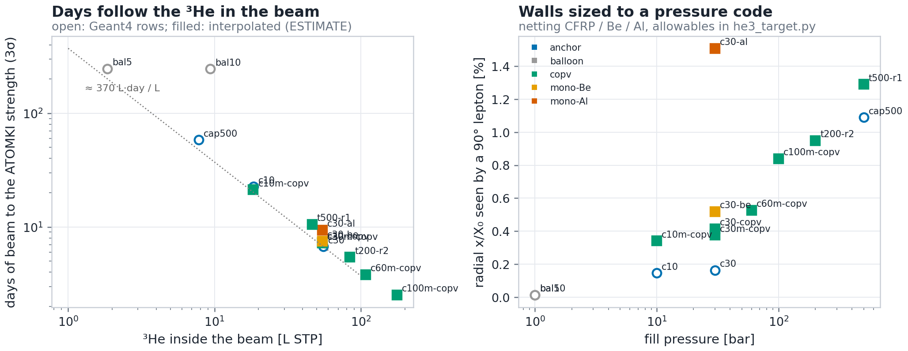

# The ³He target for a fast-neutron beam: what can be built, filled, approved and emptied (Birmingham case)

Started 2026-10-29 (dylan-MS-7C84). Dylan asked: the ³He target looks like the real blocker for Birmingham. Take it
seriously. Work out what is even possible for the target options studied for the Birmingham beam, so we know what is
worth simulating.

Inputs: the Birmingham Geant4 study (`../birmingham/TARGET_GEANT.md`, 2026-10-27) and its five targets; the vessel
scaling in `../docs/PLAN_GANIL_NFS.md` Part 4 and `../docs/anchor_vessel.py`; the leak and permeation work in
`../he4_bag/`. The numbers here come from `he3_target.py` → `out/designs.csv`. Days for designs that were not simulated
are **ESTIMATE** (interpolated from the Geant4 rows, §1.2). Facts not found publicly are marked **(ask)**. Code and legal
classes are first readings, to be confirmed with Birmingham's pressure-systems and radiation-protection officers.

## 0. Bottom line (2026-10-29)

1. **The target is not a physics blocker. It is a procurement and engineering project of about a year, with known
   technology.** Every piece exists elsewhere: thin composite pressure vessels (the n_TOF capsule is one), ³He gas
   handling (neutron-detector makers and the polarised-³He groups run it daily), ³He supply. Nobody has put the pieces
   together for us yet. No design, vendor contact, gas system or budget line exists in this repo.
2. **What you buy is litres of ³He inside the beam.** Days to the ATOMKI strength ≈ 33 · σ68[°] / L_beam[L STP],
   within 15 % for every simulated cell (§1.2). Pressure, radius and wall material only change σ68, between 11° and 16°,
   so they move the days by ≤ 40 %. The gas moves them linearly.
3. **Build C (the 6.7 d design) is not buildable as drawn, but the honest version costs only ~8 % in days.** Its
   0.3 mm CFRP is under the code thickness at 30 bar (0.45 mm at R 5 cm with a burst factor of 3). A 100 µm Be liner
   inside a CFRP tube is not a product anyone sells. Re-sized with a 0.2 mm Al liner the wall goes from 0.16 % to 0.4 %
   X₀: σ68 rises from 11.4° to 12.2° and the days from 6.7 to 7.3 (est). Even a plain 1.3 mm aluminium tube only costs
   ×1.4 (9.4 d est). **The walls are a second-order question.**
4. **Recommended baseline: 30 bar, R 4 cm (matched to the Ø8 cm beam), Al-lined CFRP with domed ends.**
   - 62 L of ³He (155 k€ at 2.5 k€/L), of which 55 L is in the beam. **~7.2 days (est).**
   - It saves 25 L (~60 k€) against build C's R 5 cm, whose outer centimetre of gas sits outside the beam and is
     paid for but not used.
   - It is a PED/PER Category I vessel (PS·V ≈ 75 bar·L): the manufacturer self-certifies (module A).
   - Fallback: the same vessel at 10 bar. 21 L, 52 k€, ~21 d (est), and below the PED threshold (sound engineering
     practice).
   - The alternative worth simulating is a **200 bar, R 2 cm tube**. Its 0.54 L is below the 1 L PED threshold. It
     holds 90 L (84 L in the beam), ~5.4 d (est), with a beam of 4× less area. It needs a 200+ bar compressor.
5. **Gas in and out is a standard closed loop**, sized in §4:
   - a storage cylinder, an all-metal gas panel with a getter purifier, and a dry pump that never exhausts ³He;
   - a **charcoal cryopump** that both fills (cold, then warmed: thermal compression to 30 bar) and recovers (to
     < 1 mbar, > 99.9 %);
   - a relief path into an **evacuated dump tank that holds the whole inventory below 1 bar**, so a relief event loses
     nothing;
   - the cell inside a **⁴He bag sniffed for mass 3**, which catches slow leaks and doubles as leak monitoring.
6. **The ³He is not consumed:** 3×10¹⁴ tritons and 10¹¹ captures in 50 days, against 2×10²⁴ atoms. So it can be
   borrowed or bought and resold. A loan from a ³He holder (ILL, ISIS, PSI, a detector programme) is the first thing to
   ask for. ³He is a controlled dual-use item (1C232), so any purchase or loan across a border needs an export licence:
   start early.
7. **The gas becomes mildly tritiated:**
   - ~0.6 MBq per 50 days from the beam's fast neutrons (σ_np/σ_nγ = 1.9×10⁴ over the Birmingham spectrum);
   - plus ~1 MBq per 10⁴ n/cm²/s of thermal neutrons returning from the room (not simulated yet);
   - ~10⁵ Bq/g of gas. That is below the UK exemption values (10⁹ Bq per premises, 10⁶ Bq/g) but above 100 Bq/g;
   - the getter takes hydrogen isotopes out. Birmingham's radiation-protection adviser has to agree the handling
     **(ask)**.
8. **Simulation, in order (§8):**
   1. Re-run the 30 bar cell with code-sized walls, domes, the valve and the fill line, at R 4 cm.
   2. Run the 200 bar R 2 cm tube with a Ø4 cm beam (does the smaller beam cut the room loads?).
   3. Score ³He(n,p) in the gas from the room-return thermal flux.
   4. Fix the capsule's gas density: Geant4's He3Gas_500bar = 62.7 mg/cm³ is the ideal-gas value. The real gas at
      500 bar and 20 °C is ~50 mg/cm³ (Z ≈ 1.24), so the capsule rows overstate its rate by ~25 % unless it was filled
      above 500 bar **(ask n_TOF)**.

---

## 1. What the target has to do

### 1.1 Requirements from the physics

| requirement | value | from |
|---|---|---|
| ³He inside the beam | as much as affordable; days ∝ 1/L_beam | TARGET_GEANT §1, §4 |
| beam | Ø8 cm collimator, 2 m from the Li, 1.4×10⁸ n/cm²/s on axis (no Pb), E_n ≤ 1.1 MeV | `bham_beam.py` |
| length | 40 cm (the Micromegas acceptance); gas beyond ±20 cm is out of acceptance | TARGET_GEANT §2 |
| radial material | ≲ 0.5 % X₀ keeps σ68 within 10 % of the best (§1.2) | this study |
| ends | in the beam, outside the acceptance: they scatter beam neutrons and convert ⁸Be γ (the correlated beam term) | TARGET_GEANT §5 |
| run | 1–4 weeks of beam, a few pressure cycles in total | |
| leak budget | 1 % of the inventory per 30 days: 2–4×10⁻⁴ mbar·L/s for the 30 bar designs | `designs.csv` |

### 1.2 Days from the Geant4 rows (the interpolation the new designs use)

Two fits to the five simulated targets (big plastics, the Pb + PE wall, `out/calibration.csv`):

- **σ68² = 10.86² + (1.41 θ₀)²**, θ₀ the Highland angle at 10 MeV/c through the radial material. It reproduces the
  balloon (10.8°), the cells (11.3–11.4°) and the capsule (14.4°). The ~11° floor is the Micromegas segment direction,
  not the target.
- **days = K · σ68 / L_beam**, with K = 32.6 from the 30 bar cell. The other rows give K = 31.6 (capsule), 36.9
  (10 bar), 42 (balloon R 5: at 2 L of gas the cosmics floor starts to matter). So the estimate is good to ~15 % for
  ≥ 10 L in the beam.
- **Not in it:** how the beam-induced background changes with the beam area. That term is ~10 % of the 30 bar cell's
  background in the reach. But the room return of the beam is half of the legs that load DREAM and the scintillators
  (TARGET_GEANT §0 item 2), so a smaller beam could matter for the loads. That needs Geant4 (§8).

---

## 2. The design space: what is possible

`he3_target.py` sizes each design with rules a pressure review would accept:
- filament-wound CFRP by netting analysis, t = 1.5 P R / 500 MPa (1500 MPa lamina strength, burst factor 3), ≥ 0.3 mm,
  on a non-structural metal liner;
- monolithic Be or Al at min(UTS/4, YS/1.5): Be 86 MPa (Materion I-70-H minimums), Al 2219-T851 114 MPa;
- hemispherical domes; design pressure PS = 1.1 × fill; real-gas ³He.

The rule reproduces the n_TOF capsule as built: 500 bar at R 10 mm needs 1.5 mm of wall, and it has 0.6 Al + 0.9 CFRP.

| design | P [bar] | R gas / beam [cm] | walls [mm] | x/X₀ | σ68 | ³He L total (in beam) | k€ | **days** | PS·V [bar·L] | PED/PER class | TNT [g] |
|---|---|---|---|---|---|---|---|---|---|---|---|
| cap500 (n_TOF capsule, Geant4) | 500 | 1 / 1 | Al 0.60 + CFRP 0.90 | 1.09 % | 14.4° | 8 (8) | 20 | **58.4** | 9 | SEP (Art 4.3) | 0.28 |
| c30 (build C, Geant4) | 30 | 5 / 4 | Be 0.10 + CFRP 0.30 | 0.16 % | 11.4° | 87 (55) | 217 | **6.7** | 104 | Cat I | 2.5 |
| c10 (Geant4) | 10 | 5 / 4 | Al 0.03 + CFRP 0.30 | 0.15 % | 11.3° | 29 (18) | 72 | **22.6** | 35 | SEP | 0.68 |
| bal5 (Geant4) | 1 | 5 / 4 | PET 0.012 + Al 0.007 | 0.01 % | 10.8° | 3 (2) | 7 | **247** | — | none | 0 |
| bal10 (Geant4) | 1 | 10 / 9 | PET 0.012 + Al 0.007 | 0.01 % | 18.2° | 12 (9) | 29 | **245** | — | none | 0 |
| c30-copv: build C, code-sized | 30 | 5 / 4 | Al 0.20 + CFRP 0.45 | 0.41 % | 12.2° | 100 (55) | 249 | **7.3** est | 121 | Cat I | 2.9 |
| **c30m-copv: baseline** | 30 | 4 / 4 | Al 0.20 + CFRP 0.36 | 0.38 % | 12.1° | 62 (55) | 155 | **7.2** est | 75 | Cat I | 1.8 |
| c30-be: monolithic Be tube | 30 | 5 / 4 | Be 1.74 | 0.52 % | 12.6° | 100 (55) | 249 | **7.5** est | 121 | Cat I | 2.9 |
| c30-al: monolithic Al tube | 30 | 5 / 4 | Al 1.32 | 1.51 % | 15.7° | 100 (55) | 249 | **9.4** est | 121 | Cat I | 2.9 |
| **c10m-copv: fallback** | 10 | 4 / 4 | Al 0.20 + CFRP 0.30 | 0.34 % | 12.0° | 21 (18) | 52 | **21.2** est | 25 | SEP | 0.49 |
| c60m-copv | 60 | 4 / 4 | Al 0.20 + CFRP 0.72 | 0.53 % | 12.6° | 122 (108) | 305 | **3.8** est | 150 | Cat I | 3.9 |
| c100m-copv | 100 | 4 / 4 | Al 0.30 + CFRP 1.20 | 0.84 % | 13.6° | 200 (176) | 500 | **2.5** est | 251 | Cat II | 6.9 |
| **t200-r2: to simulate** | 200 | 2 / 2 | Al 0.40 + CFRP 1.20 | 0.95 % | 14.0° | 90 (84) | 225 | **5.4** est | 118 | SEP (V ≤ 1 L) | 3.4 |
| t500-r1: "long capsule" | 500 | 1 / 1 | Al 0.60 + CFRP 1.50 | 1.29 % | 15.1° | 48 (47) | 120 | **10.6** est | 71 | SEP (V ≤ 1 L) | 2.1 |



What the table says:
- **Days track the gas.** The c30 variants all land at 7–9 d for 55 L in the beam, whatever the wall. Going faster
  means more gas: 60 bar gives 3.8 d (122 L, 305 k€); 100 bar gives 2.5 d (200 L, Cat II).
- **Match the cell to the beam.** At R 5 cm with a Ø8 cm beam, 36 % of the gas is outside the beam (45 % with domes).
  R 4 cm keeps 88 % in it. The price is a beam edge close to the wall: the collimator's penumbra then hits the wall, which
  needs Geant4. R 4.5 cm is a reasonable compromise to simulate.
- **Higher pressure, smaller tube, smaller beam.** For a fixed inventory the wall scales as N/(R·L), so small tubes cost
  σ68. They also shrink the beam (area ×4 smaller at R 2 cm, ×16 at R 1 cm), and below 1 L the vessel falls out of PED
  categorisation altogether. The 200 bar R 2 cm tube is the interesting point: the most gas in the beam per vessel, a
  quarter of the beam area, SEP class. The 500 bar long capsule loses to it: real-gas compressibility (Z = 1.24) and
  1.3 % X₀ of wall.
- **What it costs in days.** Any version of the 30 bar class is 7 ± 1 d. Each halving of the gas doubles the days.

### 2.1 Options considered and dropped

| option | why not |
|---|---|
| 1 bar mylar balloon (bal5/bal10) | ×30 less gas per volume: 245 d. It also cannot be pumped out, so filling needs a vacuum enclosure (`he4_bag` §6) |
| unlined CFRP | epoxy passes He: 36–54 L of ³He per 30 days through 0.3–0.45 mm at 30 bar, against a 0.6–1 L budget. A metal liner is mandatory |
| Be foil liner (0.1 mm) in CFRP (build C as drawn) | not a stock product. Be tubes are gun-drilled and turned from block; thin-wall Be practice is ~0.4 mm at small diameter and ~1 mm larger **(ask Materion)**. Use a 0.2 mm Al liner (or a self-supporting Be tube) |
| monolithic Al 2219 tube (the JLab gas-cell approach) | buildable and simple, but 1.5 % X₀ → 9.4 d. Keep as the "no composites" fallback |
| bundle of small ³He-counter-style tubes | same total wall as one tube (wall ∝ P·R per tube, R_bundle/r tubes crossed), plus 10 % packing loss. Commercial counter walls (0.5 mm) are far too thick. Only advantage: one tube failing loses 1/N of the gas |
| cryogenic gas (77 K) or liquid ³He | the inventory sets the rate, not the density. A cold cell needs a vacuum jacket (more walls, MLI) for no gain in L_beam per € |
| a longer cell | gas beyond ±20 cm is outside the Micromegas acceptance |

---

## 3. The vessel

### 3.1 Legal path (UK)

- **Design and manufacture: UK Pressure Equipment (Safety) Regulations 2016**, the UK copy of the PED. ³He is a
  group 2 (non-hazardous) gas, so Table 2 of Annex II applies, with PS = 1.1 × fill.
  - **Below the threshold** (sound engineering practice, Art 4(3); no conformity marking): V ≤ 1 L at PS ≤ 1000 bar, or
    PS·V ≤ 50 bar·L. That covers the 10 bar cell, the 200 bar R 2 cm tube, the capsule and the long capsule.
  - **Category I** (module A, self-certified): 50 < PS·V ≤ 200 bar·L, which covers every 30 and 60 bar design. The
    boundaries above 200 bar·L are taken from secondary sources and need checking.
- **In service: Pressure Systems Safety Regulations 2000.** Any system above 0.5 bar gauge with a relevant fluid needs a
  written scheme of examination by a competent person, whatever the PER class. That includes the cell, the gas panel and
  the storage cylinder. Birmingham's own pressure-systems procedure applies on top **(ask)**.
- **Transport.** A custom vessel is not an ADR/TPED-approved receptacle, so it should travel empty and be filled on
  site from an approved storage cylinder (§4). Ask a dangerous-goods adviser before assuming otherwise **(ask)**.

### 3.2 Construction

Baseline c30m-copv:
- **Liner:** 6061 or 1100 aluminium tube, 0.2 mm wall, Ø80 mm × 400 mm, with spun or machined end domes and two polar
  bosses. A seamless drawn tube avoids a weld along the acceptance.
- **Overwrap:** carbon fibre wound helically at ±55°, 0.36 mm (0.5 mm is a sensible manufacturing target; it costs
  0.05 % X₀). The domes are wound over the bosses, as in any COPV.
- **Upstream end:** a hemispherical or 2:1 ellipsoidal dome. 0.18 mm of CFRP is enough at 30 bar. Compare a flat
  aluminium plate across the full R 4 cm, which needs 5.6 mm (`designs.csv` `flat_plate_Al_mm`) and scatters beam
  neutrons accordingly. The current Geant4 cell has a 3 mm Be window over a 15 mm aperture and a 4 mm Al cap; the cap
  is under-thick for 30 bar at R 5 cm, where a flat plate needs 7 mm.
- **Downstream end:** a polar boss carrying a 1/4" VCR stub. The valve and the fill line leave sideways, outside the
  acceptance, not along the beam.
- **Volume around the valve:** ≤ 1 cm³ of dead volume between the cell and the first valve. That is 0.03 L STP at
  30 bar, and 0.2 L at 200 bar, where it starts to count.
- **Mount:** to the beam tube or the support frame at the upstream boss, outside the Micromegas acceptance.

Vendors: thin COPVs and CFRP beam pipes are made by aerospace filament-winding shops. The n_TOF capsule's maker is the
first call: who built it, to what code, who filled it, and is the design file available? **(ask n_TOF)**.

### 3.3 Qualification

1. A design calculation (laminate analysis, domes, bosses, buckling under external vacuum during evacuation; a 0.2 mm Al
   liner bonded to CFRP must not collapse at 1 bar external).
2. Prototype 1, burst test: hydrostatic, target ≥ 3 × PS = 100 bar. It also shows whether the vessel leaks or
   fragments when it fails; filament-wound CFRP normally leaks before it breaks.
3. Prototype 2, then the flight vessel:
   - proof test at 1.43 × PS (PER test pressure);
   - helium leak test at 30 bar with ⁴He: integral (bagged) < 10⁻⁶ mbar·L/s, ×300 below the budget;
   - 5–10 pressure cycles, then repeat the leak test;
   - a weekly ⁴He decay test.
4. Radiation: the fast flux on the vessel is ~10⁸ n/cm²/s, so 6×10¹⁴ n/cm² over 50 days. CFRP and aluminium are
   unaffected at this fluence; ²⁸Al decays in minutes. No concern.

---

## 4. Gas in and out

### 4.1 The panel

```
   ³He storage cylinder (TPED/DOT, supplier's)       ⁴He bag around the cell (1.01 bar, flushed)
        │                                                  │ sniff line → leak detector (mass 3)
     [V1]──┬── getter purifier ── LN2 trap ──┬──[V3]────── CELL (30 bar) ──[relief 33 bar]──┐
           │                                  │                                          │
        [P1 0–100 bar]                     [P2 capacitance 0–1000 mbar]                    │
           │                                  │                                          │
        CRYOPUMP (charcoal, 4–10 K, GM cooler or LHe dip) ──[V5]── TURBO + DRY SCROLL ──→ exhaust only
           │                                                    (closed while ³He is in the lines)
     [V4]──┴── DUMP TANK (evacuated, ≥ 120 L: holds the whole inventory below 1 bar) ◄── relief / burst disc
```

- **All-metal:** VCR/CF joints, bellows-sealed valves, no elastomers in the ³He path except the cell's own seals.
- **The getter** (Zr-based) removes H₂, H₂O, O₂, N₂ and tritium (as HT/T₂). The LN₂ trap holds condensables.
- **Fill:**
  1. Evacuate and bake the cell and the lines; leak-check the panel.
  2. Expand the cylinder into the cryopump at 4–10 K; charcoal adsorbs helium.
  3. Close it off, open it to the cell, warm the charcoal. The desorbed gas compresses into the cell, so no moving
     parts touch the ³He.
  4. Top up in steps. Read the pressure on P1 and the inventory from P2 before and after.
- **Recovery:** cool the cryopump and open it to the cell. Charcoal at 4 K pumps helium to < 10⁻³ mbar. Then warm into
  the storage cylinder, through a compressor if the cylinder pressure is above what thermal compression reaches. The
  residual in a 2.3 L cell at 1 mbar is 2×10⁻³ L STP.
- **200 bar and above:** thermal compression into a fixed volume still works, but a small all-metal diaphragm
  compressor is simpler (classes rated to 1000 bar exist; ³He/tritium compatibility is a vendor question **(ask)**).
  This is the main extra cost and complexity of the t200 option.
- **Relief:**
  - the relief valve (with a burst disc ahead of it, so the seat cannot leak) vents into the dump tank;
  - 62 L STP into a 120 L tank ends at 0.5 bar, so a relief event loses nothing;
  - a catastrophic vessel failure still vents into the ⁴He bag and the hall: the bag can be connected to the dump tank
    through a check valve, which captures part of it.
- **Monitoring:**
  - cell pressure and temperature logged; a 1 % loss at 30 bar is 0.3 bar, easy to see;
  - a mass-3 leak detector (sniffer) on the ⁴He bag. Mass-3 tuning exists on helium leak detectors (e.g. the mass 3/4
    switch of the Veeco MS-40); check current Pfeiffer/Inficon models.

Precedent and help: the ILL ³He group (Tyrex fills and recovers ³He cells daily, `../ill/POLARISED.md`), ISIS, PSI
and the neutron-detector makers (they fill tubes to 10–40 atm). The JLab tritium/³He target (40 cm Al 2219 cells,
20 bar ³He, welded, valves outside the acceptance, evacuated chamber as secondary containment, safety factor ≥ 5;
arXiv:1306.6000) is the closest nuclear-physics precedent for a 40 cm pressurised gas cell. **Borrowing or renting a
working ³He panel, or the people who run one, is quicker than building one.**

### 4.2 Losses per campaign (estimate)

| route | per campaign |
|---|---|
| residual after recovery (cell + lines at 1 mbar) | < 0.01 L |
| leaks at the 10⁻⁶ mbar·L/s acceptance level, 60 days | 0.005 L |
| relief event | 0 (dump tank) |
| getter and trap regeneration (³He held in the charcoal or trap at warm-up) | < 0.1 L if handled through the cryopump |
| **total** | **≲ 0.2 % of 62 L** |

A gas system built this way loses almost nothing. The money is in owning or borrowing the inventory.

---

## 5. The ³He

- **Quantity:**
  - baseline 62 L STP (8.3 g);
  - fallback 21 L;
  - t200 90 L;
  - add ~5 % for lines and cylinder heel.
- **Price:** ~2–2.5 k$/L for bulk gas is the most-cited figure (DOE Isotope Program 2024–25, per secondary sources).
  Purified grades are quoted up to ~10 k$/L, and there is no transparent spot price. Demand is rising (dilution
  refrigerators for quantum computing), and the DOE has signed forward purchases of lunar ³He for 2029. Treat
  2.5 k€/L as optimistic.
- **The gas is not consumed** (§0 item 6). After the run the gas is recovered, purified and either returned or resold.
  So the real cost is the loan fee, or purchase minus resale, plus the losses in §4.2.
- **Routes, in the order to try them:**
  1. **Loan** from a ³He holder with idle inventory: ILL (detectors, polarisers), ISIS (STFC, UK: no export licence),
     PSI, JCNS, ESS, or the DOE Isotope Program's loan arrangements, if any exist **(ask)**.
  2. **Purchase:** the DOE Isotope Program, or commercial suppliers (Chemgas markets itself as one; Linde and Air
     Liquide) **(ask)**.
- **Export control:** helium-3 is dual-use item 1C232 (US CCL; EU 2021/821; UK control list). Gas crossing a border
  needs an export licence, both to come in and to go back. Expect months. ISIS gas would avoid this.
- **Return conditions:** a lender will want the gas back with its purity and the tritium (§6) stated. Plan a getter pass
  and a sample analysis before returning it.

---

## 6. Tritium and radiation protection

`designs.csv` `tritium_*`. ³He(n,p)t at the beam's spectrum has σ = 1.02 b, against σ_nγ = 53 µb (ENDF/B, folded with
the 2.8 MeV thick-Li spectrum): 1.9×10⁴ tritons per capture.

| design | tritons/s, beam | MBq in 50 d, beam | MBq in 50 d per 10⁴ n/cm²/s thermal on the cell | Bq per g of gas |
|---|---|---|---|---|
| c30 (build C) | 7.9×10⁷ | 0.61 | 0.95 | 1.3×10⁵ |
| c30m-copv | 7.8×10⁷ | 0.60 | 0.68 | 1.5×10⁵ |
| c10m-copv | 2.6×10⁷ | 0.20 | 0.23 | 1.5×10⁵ |
| t200-r2 | 1.2×10⁸ | 0.92 | 0.99 | 1.6×10⁵ |

- **The thermal term is unknown.** The room returns moderated neutrons (BPE, concrete, the dump), and thermal ³He(n,p)
  is 5316 b. Geant4 can score it in the existing R2/R3 runs (§8).
- **Levels:**
  - UK EPR 2016 Schedule 23 Table 5 exemption: 10⁹ Bq per premises and 10⁶ Bq/g for H-3. The gas is below both.
  - It is above the 100 Bq/g of Table 2, so it is radioactive material in the regulatory sense, under an exemption.
- **What this means:**
  - tritium-compatible handling: all-metal, the getter as the tritium sink;
  - the pump exhaust never sees ³He;
  - a record of the activity;
  - the RPA's agreement. This is not a blocker, but it affects the return of borrowed gas **(ask)**.
- **The vessel itself:** short-lived activation only.

---

## 7. Safety case, in one table

| hazard | size (baseline) | control |
|---|---|---|
| stored energy | 7.6 kJ ≈ 1.8 g TNT (build C 10.5 kJ; capsule 1.2 kJ) | burst test ≥ 3 PS; proof test; CFRP leaks before it breaks; ⁴He bag and frame as fragment catch; exclusion zone during filling |
| overpressure (fill error, warm-up of the cryopump into the cell) | the cryopump can exceed PS if over-charged | inventory metered on P2 before warm-up; relief + burst disc into the dump tank; interlock on P1 |
| loss of ³He | up to 155 k€ | dump tank; the bag; leak monitoring |
| tritium | ≤ 2 MBq | §6 |
| beryllium | none in the baseline (Al liner) | if a Be tube is chosen: machining-dust and breakage procedures |
| asphyxiation | negligible (62 L) | none |
| vacuum | the liner buckling during evacuation | design check (§3.3) |

---

## 8. What this means for the simulation

In order of what each run decides:

1. **Code-sized baseline cell (B1–B3, R3 with the new geometry).**
   - 30 bar, R 4 cm (and R 4.5), Al 0.2 + CFRP 0.36–0.5 mm, hemispherical domes with polar bosses;
   - a downstream boss, valve and side-going fill line, all outside the acceptance;
   - the ⁴He bag (one 25 µm foil at R ~8 cm).
   - Decides: σ68 and the days for the design we would build. Is the 7.2 d estimate right? Does the beam edge at the
     wall (R 4) cost background?
   - Code change: `--target cell` needs domes, bosses and a fill line. Today it has an end ring, a window disk and a
     flat cap (MX17_Full_Geant `SimConfig.hh` cell block).
2. **The 200 bar R 2 cm tube with a Ø4 cm beam (B1–B3, R3).**
   - Decides: the days with 84 L in the beam at 1 % X₀, and whether a 4× smaller beam cuts the room return, DREAM dead
     time and the slab pile-up.
   - If it does, the high-pressure small tube wins outright. If not, the 30 bar cell stays.
3. **³He(n,p) count in the gas from the room and wall runs (R2, R3).** Decides the tritium (§6) and the thermal flux at
   the target. This is a re-reduction, not a new run.
4. **Capsule density.** He3Gas_500bar: 62.7 → ~50 mg/cm³, unless n_TOF confirms a higher fill. This rescales the cap500
   rows (×0.8 rate) and the n_TOF analyses that use the same material. Affects MX17_Full_Geant `main`.
5. Nice to have: a monolithic Al 2219 tube (the no-composite fallback, 9.4 d est) and the 60 bar R 4 cell (3.8 d est)
   to anchor the high-pressure end of §1.2.

No new physics is needed for the balloons or the old capsule: they are out.

---

## 9. Plan

### 9.1 Asks (send now)

| who | what |
|---|---|
| **Birmingham** | pressure-systems procedure and competent person; can a ³He gas panel and a dump tank sit in the experimental area; RPA view on tritiated ³He under exemption; existing gas-handling or cryogenic infrastructure (LHe, LN₂); any ³He on site |
| **n_TOF** | the 500 bar capsule: maker, code and certification, liner and laminate, who filled it and how (compressor? cryo?), the real fill pressure (the Geant4 density question) |
| **ISIS / ILL ³He group / PSI** | a 60–100 L ³He loan for ~3 months; a gas panel or a fill-and-recover service; conditions for returning gas with ≤ 2 MBq of tritium |
| **Materion** (only if Be stays in play) | thinnest seamless Be tube at Ø80–100 × 400 mm; price, lead time |
| **COPV / filament-winding shop** | an Al-lined CFRP vessel Ø80 × 400 mm, 30 bar (and 200 bar Ø40): price, lead time, test reports |
| **³He suppliers** | price and lead time for 60–100 L; buy-back terms; export licensing |

### 9.2 Phases (from go-ahead)

| months | what |
|---|---|
| 0–2 | asks out; Geant4 items 1–3 of §8; choose 30 bar R 4 vs 200 bar R 2; start the ³He request (licence clock) |
| 2–6 | vessel design and calculation; order 2 prototypes + 1 flight vessel; specify the gas panel or agree a borrowed one |
| 6–9 | burst and proof tests; leak and cycle tests with ⁴He; panel built; written scheme of examination |
| 9–12 | ⁴He dry run at Birmingham (fill, monitor, recover); ³He delivery; RPA and pressure sign-off |
| 12+ | beam |

### 9.3 Budget lines (ESTIMATE, to replace with quotes)

| item | k€ |
|---|---|
| ³He, 62 L (bought; or a loan fee) | 155 (loan: much less) |
| vessel: design, 2 prototypes, 1 flight | 30–80 |
| tests (burst, proof, leak) | 5–15 |
| gas panel: valves, VCR, gauges, getter, LN₂ trap, dump tank | 25–40 |
| cryopump: GM cryocooler + charcoal (or an LHe dip probe + LHe) | 10–80 |
| turbo + dry scroll | 10–15 |
| mass-3 leak detector | borrow (or 30) |
| diaphragm compressor (200 bar option only) | 50–150 |

None of these are on `../budget/` yet.

---

## 10. Risks, ranked

| # | risk | what to do |
|---|---|---|
| 1 | No ³He in time, or too expensive (supply tightening, export licence) | loan first (ISIS avoids the licence); fall back to 10 bar (21 L, ~21 d) |
| 2 | Al liner + CFRP leaks (bond, liner fatigue, boss seals) | ⁴He leak tests on the prototypes; Al liner thick enough to be welded (0.2–0.3 mm); metal seals at the bosses |
| 3 | Birmingham's pressure or radiation rules are stricter than the UK minimum | ask now (§9.1) |
| 4 | The days estimates for unsimulated designs (§1.2) | Geant4 §8 items 1–2 |
| 5 | The room return and the wall still dominate the loads whatever the target | TARGET_GEANT §8: the wall and collimator design are the larger risk for the measurement |
| 6 | Capsule density error propagates to the n_TOF analyses | §8 item 4; tell the nTof_x17 side |

---

## 11. Code and outputs

| file | what |
|---|---|
| `he3_target.py` | the engineering model: walls, real gas, inventory, PED class, stored energy, leak budget, tritium, days interpolation, figure |
| `out/designs.csv` | every design, every column (walls, x/X₀, σ68, ³He, cost, days, PS·V, class, TNT, domes vs plates, leak budget, unlined-CFRP permeation, tritium) |
| `out/calibration.csv` | the σ68 and days fits, σ_np/σ_nγ, the allowables |
| `out/he3_designs.png` (+ `.csv`) | days vs ³He in the beam; walls vs pressure |

Sources: Birmingham study (`../birmingham/TARGET_GEANT.md`); JLab gas-cell design, arXiv:1306.6000; UK SI 2016/1105
(PER) reg. 6 thresholds; UK SI 2016/1154 (EPR) Sch. 23 Tables 2 and 5; Materion I-70-H minimum properties;
³He price: Pulsar Helium / Visual Capitalist citing DOE IP (secondary); 1C232 in the US CCL and UK control list.
